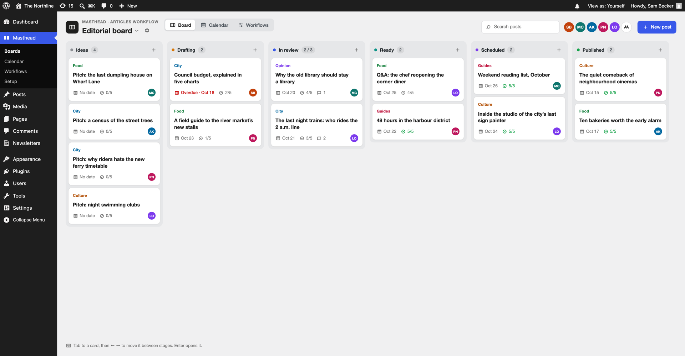
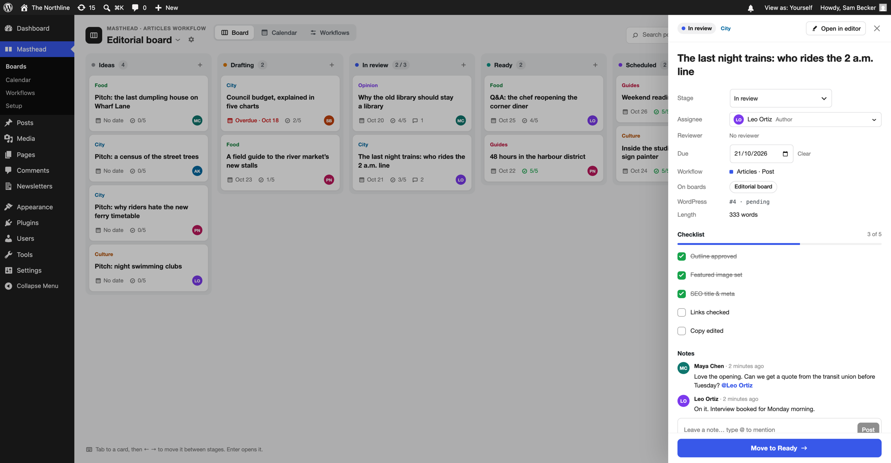
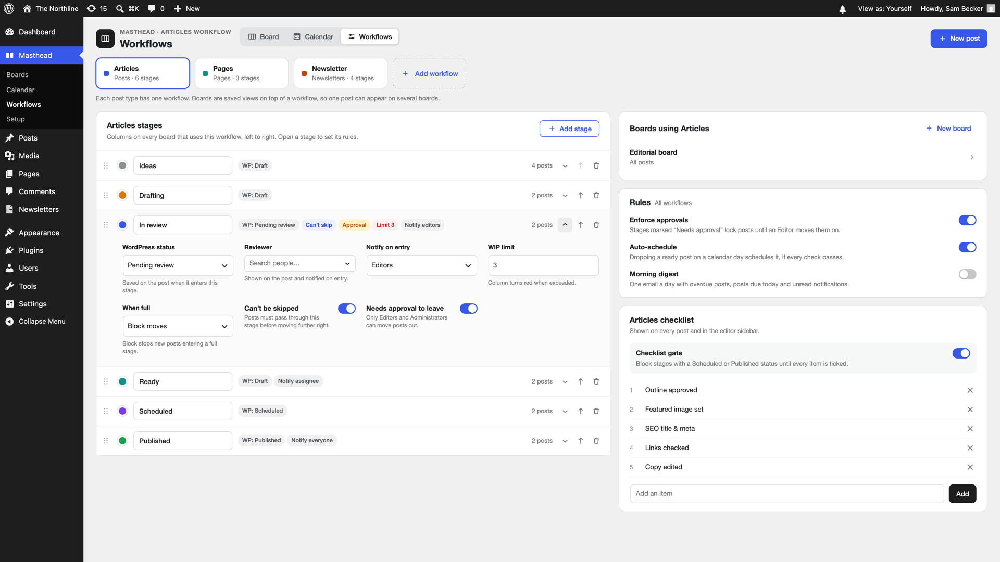
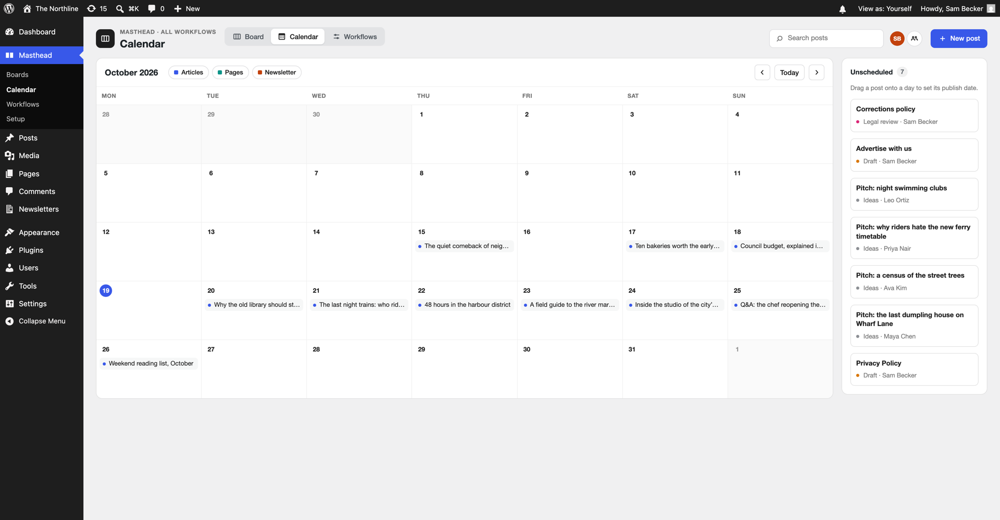
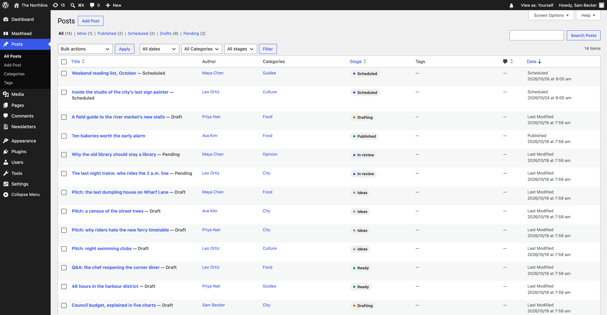
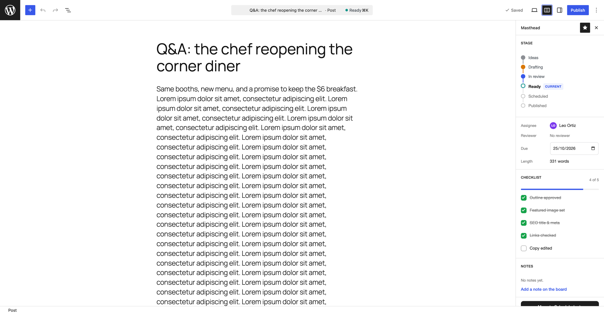
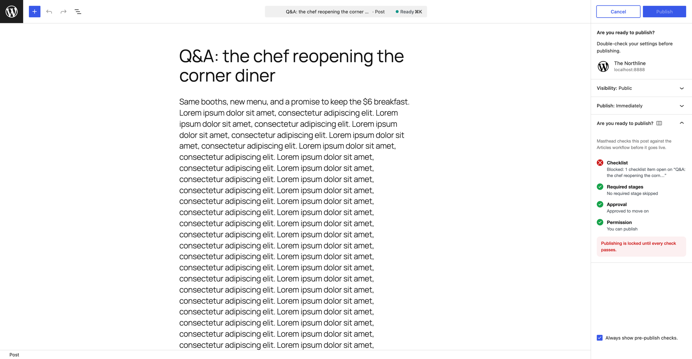
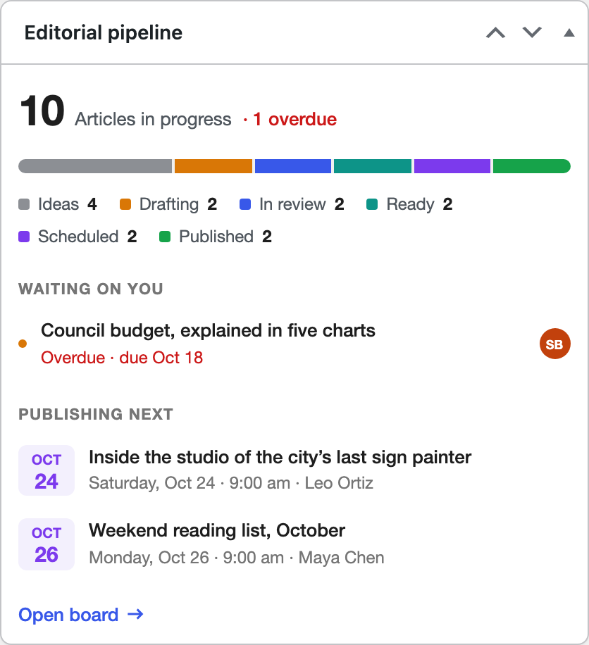

# Masthead

[](https://github.com/PatelUtkarsh/masthead/actions/workflows/ci.yml)

Kanban publishing workflows for wp-admin. A card is a post, and every stage maps to a core post status.

Requires WordPress 7.0+ and PHP 8.4+.



## Features

- **Boards:** one column per stage, drag and drop or ← → on the keyboard, WIP limits, filters by category and assignee, and saved boards per workflow.
- **Rules on the server:** required stages, approval locks, WIP limits, publish permission and a checklist gate. The same rules apply in the block editor, Quick Edit, the Posts list and the REST API.
- **Post drawer:** stage, assignee, due date, checklist, notes with @mentions, and activity.
- **Calendar:** drag posts onto days to set due dates. A ready post dropped on a day is scheduled if every check passes.
- **Workflows:** one per post type. Reorder stages, set the WordPress status, reviewer, notifications and limits per stage, and delete a stage with Undo.
- **Block editor:** a Masthead sidebar with the stage stepper and checklist, plus pre-publish checks that lock Publish until they pass.
- **Notifications:** an admin bar bell, and an optional morning email digest.

| Post drawer | Workflows |
| --- | --- |
|  |  |

| Calendar | Posts list |
| --- | --- |
|  |  |

| Editor sidebar | Pre-publish checks |
| --- | --- |
|  |  |



## Install

**Zip:** download `masthead-X.Y.Z.zip` from [Releases](https://github.com/PatelUtkarsh/masthead/releases) and upload it in **Plugins → Add New → Upload Plugin**.

**Composer:** the package is on [Packagist](https://packagist.org/packages/patelutkarsh/masthead). Release tags include the built assets, so no build step is needed.

```sh
composer require patelutkarsh/masthead
```

The package type is `wordpress-plugin`, so `composer/installers` places it in `wp-content/plugins/masthead`. To use another folder, set `installer-paths` in your project's `composer.json`:

```json
{
	"extra": {
		"installer-paths": {
			"web/app/plugins/{$name}/": [ "type:wordpress-plugin" ]
		}
	}
}
```

## Development

```sh
npm install
composer install
npm run build          # or: npm start
npm run env:start      # wp-env: PHP 8.4, WordPress 7.0 (http://localhost:8888, admin / password)
npm run test:php       # PHPUnit inside wp-env
npm run test:e2e       # Playwright against the tests site (http://localhost:8889)
composer lint          # PHPCS (WordPress-Extra + PHPCompatibilityWP)
npm run lint:js
npm run lint:css
```

`build/` is not tracked on `main`. Run `npm run build` after you clone.

### Layout

- `masthead.php`: bootstrap and autoloader (`Masthead\` → `includes/`).
- `includes/`: PHP. `Rules` (rule engine), `Sync` (status sync), `Guard` (enforcement on REST, Quick Edit and other screens), `StageTaxonomy` (stage storage), `Rest/*` (REST API `masthead/v1`), `Notifications`, `Activity`, `Notes`, `ListTable`, `Dashboard`, `Cron`, `Capabilities`, `Install`.
- `src/`: React entry points `admin-app`, `editor-plugin`, `dashboard-widget`, `list-table`, `admin-bar`, plus the `masthead/core` store.
- `tests/php`: PHPUnit. `tests/e2e`: Playwright.
- `bin/`: release scripts.

## CI and releases

**CI** (`.github/workflows/ci.yml`) runs on every push to `main` and on pull requests:

- Lint: PHPCS, PHP syntax, ESLint, Stylelint and a production build.
- PHPUnit in wp-env, single site and multisite: PHP 8.4 with WordPress 7.0, PHP 8.4 with the latest WordPress, and PHP 8.5 with the latest WordPress.
- Playwright end-to-end tests in wp-env.

**Releases** keep `build/` out of `main` but in every release:

1. Bump the version on `main` and merge it: `bin/bump-version.sh 1.2.0` updates the plugin header, the `VERSION` constant and `package.json`.
2. Run **Actions → Release → Run workflow** on `main` with the version `1.2.0`.

The workflow runs the full CI suite, checks every version string (`bin/check-version.sh`), and builds the plugin (`bin/package.sh`). It then makes a release commit on top of `main` that adds `build/`, tags it `v1.2.0` and pushes only the tag. `main` itself never changes. Finally it publishes a GitHub release with `masthead-1.2.0.zip`.

Composer installs from tags, so it gets `build/`. `.gitattributes` keeps development files (`src/`, `tests/`, tooling) out of Composer's dist archive. `.distignore` does the same for the zip.

## Notes

- Blocked status changes from Quick Edit show the rule message in the Quick Edit row. Other non-REST screens keep the old status and show an admin notice.
- The editor locks saving (`lockPostSaving('masthead')`) only while the pre-publish panel is open and a check fails, so drafts can still be saved.
- "View as" in the admin bar is available only when `WP_DEBUG` is on, only to administrators, and it can only remove capabilities.

## Large sites

Stages are stored as terms of an internal, non-public taxonomy (`masthead_stage`, one term per workflow stage, slug `{workflow}__{stage}`). Term relationships are indexed by term, so a board column reads only the posts in that stage. The term count column, which counts draft, pending, future, publish and private posts, gives per-stage totals without a query. REST responses expose the stage as the read-only field `masthead_stage`. On 176k posts this cut the six-column board query from about 800 ms (post meta) to about 140 ms.

Masthead also loads data on demand and avoids `COUNT` queries on hot paths:

- No user or category lists ship with the page. Assignee, reviewer, board filters, the assignee avatar filter and @mentions search `/masthead/v1/users` (or core `/wp/v2/categories`) 20 at a time.
- Lists page by fetching one extra row (`has_more`) instead of using `SQL_CALC_FOUND_ROWS`. Board columns load 20 cards and fetch the next page when you scroll to the end. Filtered columns show "20+".
- Per-stage totals (used for WIP limits) come from the stage terms' count column. Board counts load only when the board switcher opens.
- Notifications insert in one multi-row query per 500 recipients. Mentions are capped at 20 people per note.
- Setup import, stage deletion and Undo write stage terms with set-based SQL and recount once. Status changes for more than 100 posts, imports past 500 posts, checklist clean-up and the morning digest run in WP-Cron batches.
